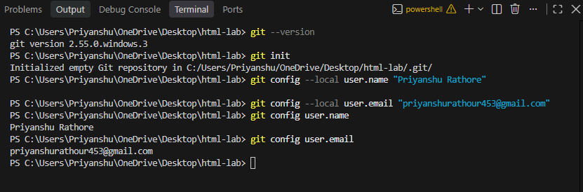
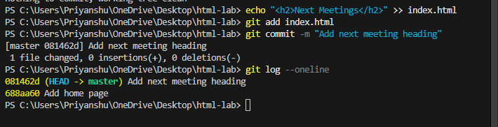
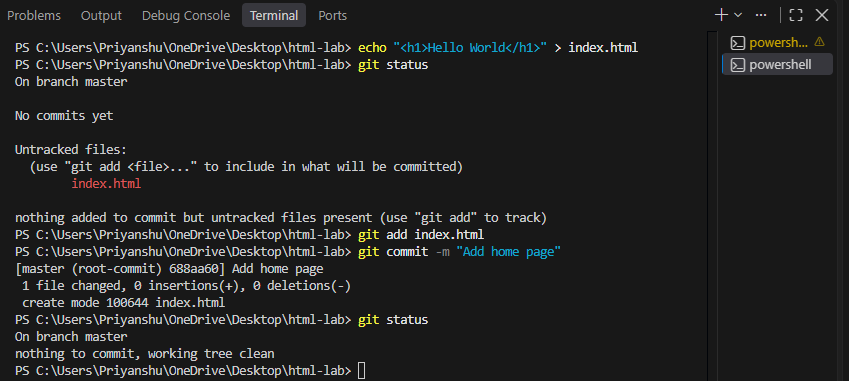

Name: Priyanshu Rathore

Student Id: BCS2025380

Roll No: 2510303398

Branch: Computer Science and Engineering

Year: IInd

Section: E

# Experiment No. 1

## Experiment Title
Starting a Git Repository

## Aim
Start a Git repository for your lab folder and save your work with commits.

## Software / Tools Required
Git, Visual Studio Code (terminal)

## Theory
- Git is a version control tool. It saves versions of your work so that you can go back to them. git init starts a repository in a folder.
- git config sets the name and email used in commits. With --local it applies only to this repository.
- git status shows which files are new or changed. git add puts a file in the staging area and git commit -m saves a snapshot with a message.
- git log --oneline lists the commits, newest first.

## Algorithm / Procedure
1. Open Visual Studio Code and the terminal.
2. Task 1: Create folder html-lab, run git init, set name and email with git config --local, and show them.
3. Task 2: Create index.html with one h1, run git status, add the file and commit with message Add home page.
4. Task 3: Add an h2 below the h1, commit with message Add next meeting heading, run git log --oneline.
5. Run the commands one by one in the terminal.
6. Take a screenshot of the terminal output after each task and save it in the images folder.

## Program / Commands
### Commands
```
# ---------- Task 1 ----------
mkdir html-lab
cd html-lab
git init
git config --local user.name "Priyanshu Rathore"
git config --local user.email "your-email@example.com"
git config user.name
git config user.email

# ---------- Task 2 ----------
# Create index.html in VS Code inside html-lab with content:
#   <h1>Welcome to my page</h1>
git status
git add index.html
git commit -m "Add home page"

# ---------- Task 3 ----------
# Add this line below the h1 in index.html and save:
#   <h2>Next meeting</h2>
git add index.html
git commit -m "Add next meeting heading"
git log --oneline
```

## Input
Not Applicable. The values are written inside the program.

## Output
Output of the commands in the terminal (screenshots):





## Result
The experiment was performed successfully. A Git repository was started, files were committed and the commit history was shown.

## Viva-Voce Questions
1. What is Git?
2. What is the difference between git add and git commit?
3. What does git log --oneline show?
4. What does git init do?
