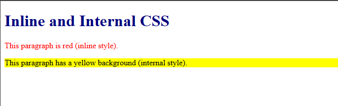
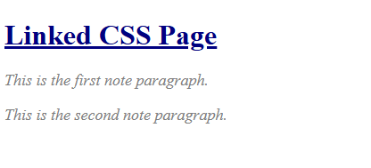
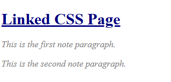

# Experiment No. 10

## Experiment Title
CSS Fundamentals

## Aim
Apply CSS in three ways (inline, internal and linked) and use selectors and text styles.

## Software / Tools Required
HTML5, CSS3, Visual Studio Code (with Live Server), Google Chrome

## Theory
- CSS (Cascading Style Sheets) controls how a page looks.
- There are three ways to add CSS: inline (style attribute), internal (style tag in the head) and external (a .css file linked with link).
- Selectors choose elements: an element name (h1), a class (.note) or an id (#title).

## Algorithm / Procedure
1. Open Visual Studio Code and create the folder Lab10.
2. Task 1: inline-internal.html: internal style (h1 navy, .highlight yellow) and an inline red paragraph.
3. Task 2: style.css: h1 navy, .note italic, #title underlined, p 18px grey.
4. Task 3: linked.html: links style.css, h1 with id title and two paragraphs with class note.
5. Save all the files.
6. Open each html file with Live Server in Google Chrome.
7. Check the page and take a screenshot of each task and save it in the images folder.

## Program / Commands
### inline-internal.html
```html
<!DOCTYPE html>
<html lang="en">
<head>
  <meta charset="UTF-8">
  <title>Inline and Internal CSS</title>
  <style>
    h1 {
      color: navy;
    }
    .highlight {
      background-color: yellow;
    }
  </style>
</head>
<body>
  <h1>Inline and Internal CSS</h1>
  <p style="color: red;">This paragraph is red (inline style).</p>
  <p class="highlight">This paragraph has a yellow background (internal style).</p>
</body>
</html>
```

### style.css
```css
h1 {
  color: navy;
}

.note {
  font-style: italic;
}

#title {
  text-decoration: underline;
}

p {
  font-size: 18px;
  color: grey;
}
```

### linked.html
```html
<!DOCTYPE html>
<html lang="en">
<head>
  <meta charset="UTF-8">
  <title>Linked CSS</title>
  <link rel="stylesheet" href="style.css">
</head>
<body>
  <h1 id="title">Linked CSS Page</h1>
  <p class="note">This is the first note paragraph.</p>
  <p class="note">This is the second note paragraph.</p>
</body>
</html>
```

## Input
Not Applicable. The values are written inside the program.

## Output
Expected output: Navy heading, one red paragraph and one yellow paragraph. The linked page is styled only when style.css is in the same folder.





## Result
The experiment was performed successfully. Inline, internal and external CSS were applied with element, class and id selectors.

## Viva-Voce Questions
1. Name the three ways to add CSS.
2. What is the difference between a class selector and an id selector?
3. Which way of adding CSS has the highest priority?
4. What does the color property do?
