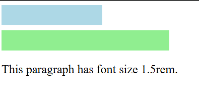
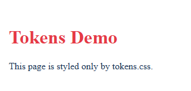
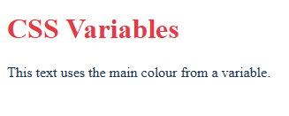

# Experiment No. 11

## Experiment Title
Units and CSS Variables

## Aim
Use CSS units and store colours and spacing in variables.

## Software / Tools Required
HTML5, CSS3, Visual Studio Code (with Live Server), Google Chrome

## Theory
- px is a fixed unit, % is relative to the parent element and rem is relative to the root font size.
- A CSS variable is defined with two dashes inside :root (for example --main-color) and used with var(). Changing it in one place changes it everywhere.

## Algorithm / Procedure
1. Open Visual Studio Code and create the folder Lab11.
2. Task 1: units.html: a 200px wide box, a 50% wide box (both 40px high, with background) and a 1.5rem paragraph.
3. Task 2: variables.html: --main-color, --accent-color and --page-padding in :root, used with var().
4. Task 3: tokens.css: variables for primary colour, accent colour, heading size and spacing, used for body and h1.
5. Save all the files.
6. Open each html file with Live Server in Google Chrome.
7. Check the page and take a screenshot of each task and save it in the images folder.

## Program / Commands
### units.html
```html
<!DOCTYPE html>
<html lang="en">
<head>
  <meta charset="UTF-8">
  <title>Units</title>
  <style>
    .box1 {
      width: 200px;
      height: 40px;
      background-color: lightblue;
      margin-bottom: 10px;
    }
    .box2 {
      width: 50%;
      height: 40px;
      background-color: lightgreen;
    }
    p {
      font-size: 1.5rem;
    }
  </style>
</head>
<body>
  <div class="box1"></div>
  <div class="box2"></div>
  <p>This paragraph has font size 1.5rem.</p>
</body>
</html>
```

### variables.html
```html
<!DOCTYPE html>
<html lang="en">
<head>
  <meta charset="UTF-8">
  <title>CSS Variables</title>
  <style>
    :root {
      --main-color: #1d3557;
      --accent-color: #e63946;
      --page-padding: 20px;
    }
    body {
      color: var(--main-color);
      padding: var(--page-padding);
    }
    h1 {
      color: var(--accent-color);
    }
  </style>
</head>
<body>
  <h1>CSS Variables</h1>
  <p>This text uses the main colour from a variable.</p>
</body>
</html>
```

### tokens.css
```css
:root {
  --primary-color: #1d3557;
  --accent-color: #e63946;
  --heading-size: 2rem;
  --spacing: 16px;
}

body {
  color: var(--primary-color);
  padding: var(--spacing);
}

h1 {
  color: var(--accent-color);
  font-size: var(--heading-size);
}
```

### tokens-demo.html
```html
<!DOCTYPE html>
<html lang="en">
<head>
  <meta charset="UTF-8">
  <title>Tokens Demo</title>
  <link rel="stylesheet" href="tokens.css">
</head>
<body>
  <h1>Tokens Demo</h1>
  <p>This page is styled only by tokens.css.</p>
</body>
</html>
```

## Input
Not Applicable. The values are written inside the program.

## Output
Expected output: A 200 pixel box, a half-width box and larger text. In variables.html the heading is red-pink (accent) and the text dark blue (main). tokens-demo.html shows tokens.css in use (I added it so you can take a screenshot for Task 3).





## Result
The experiment was performed successfully. CSS units and CSS variables were used to style pages.

## Viva-Voce Questions
1. What is the difference between px, % and rem?
2. What is a CSS variable?
3. How is a CSS variable used?
4. Why are variables written inside :root?
