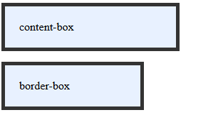
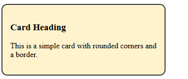
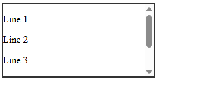

# Experiment No. 12

## Experiment Title
Box Model, Cards and Scrolling

## Aim
Compare the box sizing types, style a card and make a box scroll.

## Software / Tools Required
HTML5, CSS3, Visual Studio Code (with Live Server), Google Chrome

## Theory
- The box model says every element is a box made of content, padding, border and margin.
- With box-sizing content-box the width is only the content, so padding and border make the box wider. With border-box the width includes padding and border.
- border-radius rounds the corners and overflow auto adds a scrollbar when the content does not fit.

## Algorithm / Procedure
1. Open Visual Studio Code and create the folder Lab12.
2. Task 1: box-model.html: two boxes (width 200px, padding 20px, border 5px), content-box and border-box.
3. Task 2: card.html: card with background, 2px border, 12px rounded corners and 16px padding.
4. Task 3: scroll.html: 120px high box with overflow auto and five lines of text.
5. Save all the files.
6. Open each html file with Live Server in Google Chrome.
7. Check the page and take a screenshot of each task and save it in the images folder.

## Program / Commands
### box-model.html
```html
<!DOCTYPE html>
<html lang="en">
<head>
  <meta charset="UTF-8">
  <title>Box Model</title>
  <style>
    .box {
      width: 200px;
      padding: 20px;
      border: 5px solid #333;
      background-color: #e8f1ff;
      margin-bottom: 15px;
    }
    .content-box {
      box-sizing: content-box;
    }
    .border-box {
      box-sizing: border-box;
    }
  </style>
</head>
<body>
  <div class="box content-box">content-box</div>
  <div class="box border-box">border-box</div>
</body>
</html>
```

### card.html
```html
<!DOCTYPE html>
<html lang="en">
<head>
  <meta charset="UTF-8">
  <title>Card</title>
  <style>
    .card {
      background-color: #fff3cd;
      border: 2px solid #333;
      border-radius: 12px;
      padding: 16px;
      width: 300px;
    }
  </style>
</head>
<body>
  <div class="card">
    <h3>Card Heading</h3>
    <p>This is a simple card with rounded corners and a border.</p>
  </div>
</body>
</html>
```

### scroll.html
```html
<!DOCTYPE html>
<html lang="en">
<head>
  <meta charset="UTF-8">
  <title>Scroll</title>
  <style>
    .scroll-box {
      height: 120px;
      width: 250px;
      overflow: auto;
      border: 2px solid #333;
    }
  </style>
</head>
<body>
  <div class="scroll-box">
    <p>Line 1</p>
    <p>Line 2</p>
    <p>Line 3</p>
    <p>Line 4</p>
    <p>Line 5</p>
  </div>
</body>
</html>
```

## Input
Not Applicable. The values are written inside the program.

## Output
Expected output: The content-box box is wider than the border-box box (250px vs 200px total). A card with rounded corners. The lines do not fit in the box so it scrolls.





## Result
The experiment was performed successfully. The box model, a card and a scrolling box were styled.

## Viva-Voce Questions
1. What is the box model?
2. What is the difference between content-box and border-box?
3. What does border-radius do?
4. What does overflow auto do?
