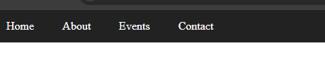
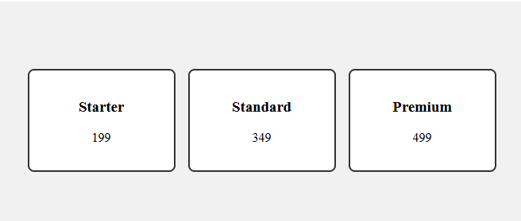
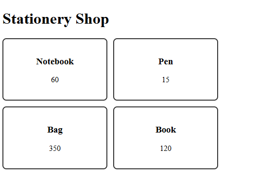

# Experiment No. 13

## Experiment Title
Flexbox Layouts

## Aim
Lay out a navigation bar, centred cards and cards that wrap, using Flexbox.

## Software / Tools Required
HTML5, CSS3, Visual Studio Code (with Live Server), Google Chrome

## Theory
- Flexbox lays items out in a row or column. It is turned on with display flex on the container.
- justify-content aligns items along the main direction and align-items aligns them across it. gap sets the space between items.
- flex-wrap lets items move to a new row when there is not enough space.

## Algorithm / Procedure
1. Open Visual Studio Code and create the folder Lab13.
2. Task 1: nav-flex.html: flex navigation bar with Home, About, Events, Contact, dark background, white links.
3. Task 2: centred-cards.html: row of three cards (Starter 199, Standard 349, Premium 499) centred with justify-content and align-items.
4. Task 3: wrapping-cards.html: Stationery Shop with four cards in a flex-wrap row.
5. Save all the files.
6. Open each html file with Live Server in Google Chrome.
7. Check the page and take a screenshot of each task and save it in the images folder.

## Program / Commands
### nav-flex.html
```html
<!DOCTYPE html>
<html lang="en">
<head>
  <meta charset="UTF-8">
  <title>Flex Navigation</title>
  <style>
    body {
      margin: 0;
    }
    nav {
      display: flex;
      background-color: #222;
    }
    nav a {
      color: white;
      padding: 14px 20px;
      text-decoration: none;
    }
  </style>
</head>
<body>
  <nav>
    <a href="#">Home</a>
    <a href="#">About</a>
    <a href="#">Events</a>
    <a href="#">Contact</a>
  </nav>
</body>
</html>
```

### centred-cards.html
```html
<!DOCTYPE html>
<html lang="en">
<head>
  <meta charset="UTF-8">
  <title>Centred Cards</title>
  <style>
    .row {
      display: flex;
      justify-content: center;
      align-items: center;
      gap: 16px;
      height: 300px;
      background-color: #f1f1f1;
    }
    .card {
      border: 2px solid #333;
      border-radius: 8px;
      padding: 16px;
      width: 150px;
      text-align: center;
      background-color: white;
    }
  </style>
</head>
<body>
  <div class="row">
    <div class="card"><h3>Starter</h3><p>199</p></div>
    <div class="card"><h3>Standard</h3><p>349</p></div>
    <div class="card"><h3>Premium</h3><p>499</p></div>
  </div>
</body>
</html>
```

### wrapping-cards.html
```html
<!DOCTYPE html>
<html lang="en">
<head>
  <meta charset="UTF-8">
  <title>Wrapping Cards</title>
  <style>
    .row {
      display: flex;
      flex-wrap: wrap;
      gap: 12px;
    }
    .card {
      border: 2px solid #333;
      border-radius: 8px;
      padding: 16px;
      width: 180px;
      text-align: center;
    }
  </style>
</head>
<body>
  <h1>Stationery Shop</h1>
  <div class="row">
    <div class="card"><h3>Notebook</h3><p>60</p></div>
    <div class="card"><h3>Pen</h3><p>15</p></div>
    <div class="card"><h3>Bag</h3><p>350</p></div>
    <div class="card"><h3>Book</h3><p>120</p></div>
  </div>
</body>
</html>
```

## Input
Not Applicable. The values are written inside the program.

## Output
Expected output: A dark bar with four white links. Three cards centred in a row. On a narrow window the shop cards wrap onto new rows.





## Result
The experiment was performed successfully. A navigation bar, centred cards and wrapping cards were built with Flexbox.

## Viva-Voce Questions
1. What is Flexbox?
2. What does justify-content do?
3. What does flex-wrap do?
4. What is the difference between justify-content and align-items?
