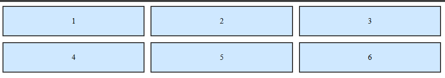
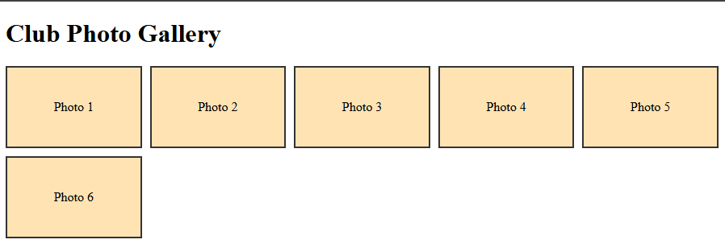
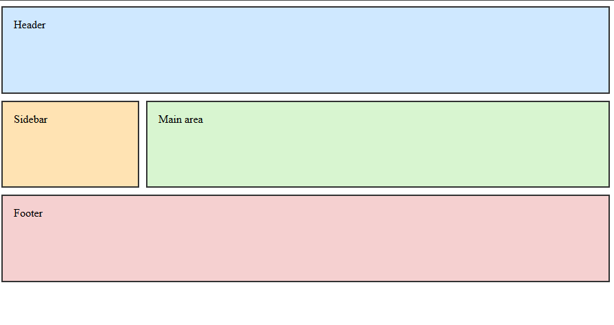

# Experiment No. 14

## Experiment Title
CSS Grid Layouts

## Aim
Make a grid with equal columns, a responsive gallery and a layout with named areas.

## Software / Tools Required
HTML5, CSS3, Visual Studio Code (with Live Server), Google Chrome

## Theory
- CSS Grid lays items out in rows and columns at the same time.
- grid-template-columns sets the columns. The fr unit is a share of the free space, and gap sets the space between boxes.
- repeat(auto-fill, minmax(150px, 1fr)) fits as many columns as the width allows.
- grid-template-areas gives names to regions and grid-area puts an element in a named region.

## Algorithm / Procedure
1. Open Visual Studio Code and create the folder Lab14.
2. Task 1: grid-first.html: six boxes (1 to 6) in three equal fr columns with a 12px gap.
3. Task 2: gallery.html: Club Photo Gallery with six boxes using repeat(auto-fill, minmax(150px, 1fr)) and a 10px gap.
4. Task 3: dashboard-areas.html: grid 200px and 1fr with named areas header, sidebar, main and footer.
5. Save all the files.
6. Open each html file with Live Server in Google Chrome.
7. Check the page and take a screenshot of each task and save it in the images folder.

## Program / Commands
### grid-first.html
```html
<!DOCTYPE html>
<html lang="en">
<head>
  <meta charset="UTF-8">
  <title>First Grid</title>
  <style>
    .grid {
      display: grid;
      grid-template-columns: 1fr 1fr 1fr;
      gap: 12px;
    }
    .grid div {
      background-color: #cfe8ff;
      border: 2px solid #333;
      padding: 20px;
      text-align: center;
    }
  </style>
</head>
<body>
  <div class="grid">
    <div>1</div>
    <div>2</div>
    <div>3</div>
    <div>4</div>
    <div>5</div>
    <div>6</div>
  </div>
</body>
</html>
```

### gallery.html
```html
<!DOCTYPE html>
<html lang="en">
<head>
  <meta charset="UTF-8">
  <title>Photo Gallery</title>
  <style>
    .gallery {
      display: grid;
      grid-template-columns: repeat(auto-fill, minmax(150px, 1fr));
      gap: 10px;
    }
    .gallery div {
      background-color: #ffe3b3;
      border: 2px solid #333;
      padding: 40px 10px;
      text-align: center;
    }
  </style>
</head>
<body>
  <h1>Club Photo Gallery</h1>
  <div class="gallery">
    <div>Photo 1</div>
    <div>Photo 2</div>
    <div>Photo 3</div>
    <div>Photo 4</div>
    <div>Photo 5</div>
    <div>Photo 6</div>
  </div>
</body>
</html>
```

### dashboard-areas.html
```html
<!DOCTYPE html>
<html lang="en">
<head>
  <meta charset="UTF-8">
  <title>Dashboard</title>
  <style>
    .dashboard {
      display: grid;
      grid-template-columns: 200px 1fr;
      grid-template-areas:
        "header header"
        "sidebar main"
        "footer footer";
      gap: 10px;
      min-height: 400px;
    }
    .dashboard div {
      border: 2px solid #333;
      padding: 16px;
    }
    .header  { grid-area: header;  background-color: #cfe8ff; }
    .sidebar { grid-area: sidebar; background-color: #ffe3b3; }
    .main    { grid-area: main;    background-color: #d8f5d0; }
    .footer  { grid-area: footer;  background-color: #f5d0d0; }
  </style>
</head>
<body>
  <div class="dashboard">
    <div class="header">Header</div>
    <div class="sidebar">Sidebar</div>
    <div class="main">Main area</div>
    <div class="footer">Footer</div>
  </div>
</body>
</html>
```

## Input
Not Applicable. The values are written inside the program.

## Output
Expected output: Six boxes in two rows of three. More photo boxes fit per row as the window gets wider. A header across the top, sidebar left, main right and footer at the bottom.





## Result
The experiment was performed successfully. Grid layouts, a responsive gallery and a layout with named areas were built.

## Viva-Voce Questions
1. What is CSS Grid?
2. What is the fr unit?
3. What does repeat(auto-fill, minmax(150px, 1fr)) do?
4. What are grid-template-areas?
