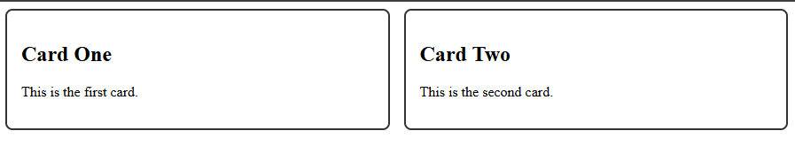
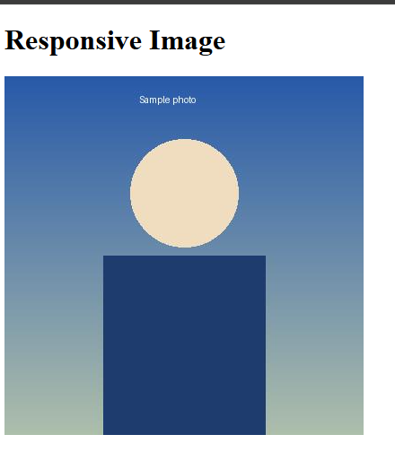
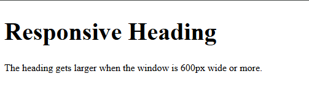

# Experiment No. 15

## Experiment Title
Responsive Pages with Media Queries

## Aim
Use a media query to change a layout, make a picture scale with its box, and set text sizes with rem units.

## Software / Tools Required
HTML5, CSS3, Visual Studio Code (with Live Server), Google Chrome

## Theory
- Responsive design makes a page look good on every screen size.
- The viewport meta tag tells phones to use their real screen width.
- Mobile-first means writing base styles for phones and then using a media query such as min-width 600px to change the layout for bigger screens.
- max-width 100% with height auto makes a picture shrink to fit its box. rem units scale with the root font size.

## Algorithm / Procedure
1. Open Visual Studio Code and create the folder Lab15.
2. Task 1: mobile-first.html: viewport meta tag, two cards that stack on phones and sit side by side at 600px and up.
3. Task 2: responsive-image.html: heading and a picture with max-width 100% and height auto.
4. Task 3: responsive-text.html: body 1rem, h1 1.5rem, and h1 2.5rem at 600px and up.
5. Save all the files.
6. Open each html file with Live Server in Google Chrome.
7. Check the page and take a screenshot of each task and save it in the images folder.

## Program / Commands
### mobile-first.html
```html
<!DOCTYPE html>
<html lang="en">
<head>
  <meta charset="UTF-8">
  <meta name="viewport" content="width=device-width, initial-scale=1.0">
  <title>Mobile First</title>
  <style>
    .card {
      border: 2px solid #333;
      border-radius: 8px;
      padding: 16px;
      margin-bottom: 12px;
    }
    @media (min-width: 600px) {
      .cards {
        display: flex;
        gap: 16px;
      }
      .card {
        flex: 1;
      }
    }
  </style>
</head>
<body>
  <div class="cards">
    <div class="card">
      <h2>Card One</h2>
      <p>This is the first card.</p>
    </div>
    <div class="card">
      <h2>Card Two</h2>
      <p>This is the second card.</p>
    </div>
  </div>
</body>
</html>
```

### responsive-image.html
```html
<!DOCTYPE html>
<html lang="en">
<head>
  <meta charset="UTF-8">
  <meta name="viewport" content="width=device-width, initial-scale=1.0">
  <title>Responsive Image</title>
  <style>
    img {
      max-width: 100%;
      height: auto;
    }
  </style>
</head>
<body>
  <h1>Responsive Image</h1>
  
</body>
</html>
```

### responsive-text.html
```html
<!DOCTYPE html>
<html lang="en">
<head>
  <meta charset="UTF-8">
  <meta name="viewport" content="width=device-width, initial-scale=1.0">
  <title>Responsive Text</title>
  <style>
    body {
      font-size: 1rem;
    }
    h1 {
      font-size: 1.5rem;
    }
    @media (min-width: 600px) {
      h1 {
        font-size: 2.5rem;
      }
    }
  </style>
</head>
<body>
  <h1>Responsive Heading</h1>
  <p>The heading gets larger when the window is 600px wide or more.</p>
</body>
</html>
```

## Input
Not Applicable. The values are written inside the program.

## Output
Expected output: On a narrow window the cards stack; at 600px and up they sit two per row. The picture shrinks to fit a narrow window. The heading is larger at 600px or more. To test, press F12 in Chrome and use the phone icon (device toolbar), or resize the window.





## Result
The experiment was performed successfully. Responsive pages were built with a media query, a scalable image and responsive text.

## Viva-Voce Questions
1. What is responsive design?
2. What does the viewport meta tag do?
3. What is a media query?
4. What does mobile-first mean?
