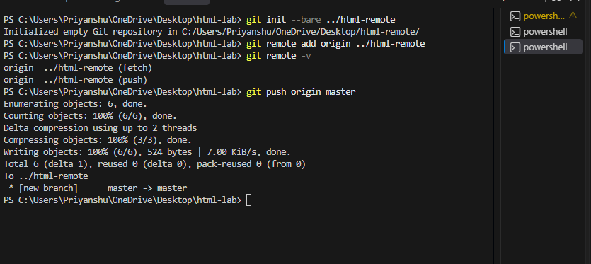
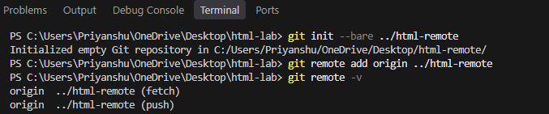
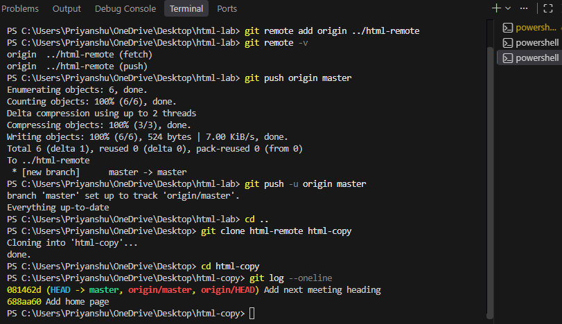

# Experiment No. 2

## Experiment Title
Pushing and Cloning a Repository

## Aim
Send your commits to a second repository on your computer and make a copy of it with clone.

## Software / Tools Required
Git, Visual Studio Code (terminal)

## Theory
- A remote repository is another copy of the repository. A bare repository has no working files and is used only to share commits.
- git remote add origin links the remote and git remote -v shows the links.
- git push sends your commits to the remote. git clone makes a full copy, with its history, in a new folder.

## Algorithm / Procedure
1. Open Visual Studio Code and the terminal.
2. Task 1: Run git init --bare ../html-remote, add it as origin and run git remote -v.
3. Task 2: Push your commits with git push origin main (use master if git status says On branch master).
4. Task 3: Go up one folder, clone html-remote into html-copy and run git log --oneline inside it.
5. Run the commands one by one in the terminal.
6. Take a screenshot of the terminal output after each task and save it in the images folder.

## Program / Commands
### Commands
```
# ---------- Task 1 ----------
cd html-lab
git init --bare ../html-remote
git remote add origin ../html-remote
git remote -v

# ---------- Task 2 ----------
git push origin main
# If git status shows "On branch master", use this instead:
# git push origin master

# ---------- Task 3 ----------
cd ..
git clone html-remote html-copy
cd html-copy
git log --oneline
```

## Input
Not Applicable. The values are written inside the program.

## Output
Output of the commands in the terminal (screenshots):





## Result
The experiment was performed successfully. Commits were pushed to a remote repository and the repository was cloned.

## Viva-Voce Questions
1. What is a bare repository?
2. What does git remote add origin do?
3. What is the difference between git push and git clone?
4. What does git remote -v show?
