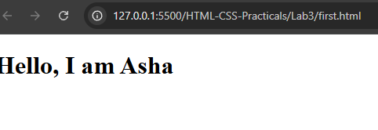
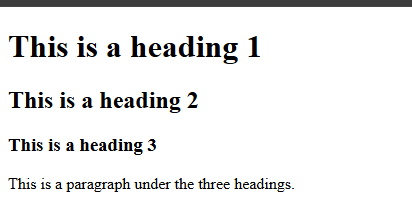
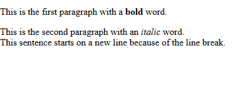

# Experiment No. 3

## Experiment Title
Your First HTML Page

## Aim
Write a first HTML page with a title, headings and a paragraph, and format some text.

## Software / Tools Required
HTML5, CSS3, Visual Studio Code (with Live Server), Google Chrome

## Theory
- HTML (HyperText Markup Language) describes the structure of a web page using tags. A basic page has DOCTYPE, html, head, title and body.
- Headings go from h1 (largest) to h6 (smallest). p makes a paragraph.
- strong makes text bold, em makes it italic and br starts a new line.

## Algorithm / Procedure
1. Open Visual Studio Code and create the folder Lab3.
2. Task 1: first.html: title My First Page and one h1: Hello, I am Asha.
3. Task 2: headings.html: h1, h2, h3 and one paragraph.
4. Task 3: text-format.html: two paragraphs with strong, em and a line break.
5. Save all the files.
6. Open each html file with Live Server in Google Chrome.
7. Check the page and take a screenshot of each task and save it in the images folder.

## Program / Commands
### first.html
```html
<!DOCTYPE html>
<html lang="en">
<head>
  <meta charset="UTF-8">
  <title>My First Page</title>
</head>
<body>
  <h1>Hello, I am Asha</h1>
</body>
</html>
```

### headings.html
```html
<!DOCTYPE html>
<html lang="en">
<head>
  <meta charset="UTF-8">
  <title>Headings</title>
</head>
<body>
  <h1>This is a heading 1</h1>
  <h2>This is a heading 2</h2>
  <h3>This is a heading 3</h3>
  <p>This is a paragraph under the three headings.</p>
</body>
</html>
```

### text-format.html
```html
<!DOCTYPE html>
<html lang="en">
<head>
  <meta charset="UTF-8">
  <title>Text Format</title>
</head>
<body>
  <p>This is the first paragraph with a <strong>bold</strong> word.</p>
  <p>This is the second paragraph with an <em>italic</em> word.<br>
  This sentence starts on a new line because of the line break.</p>
</body>
</html>
```

## Input
Not Applicable. The values are written inside the program.

## Output
Expected output: Tab says My First Page with one large heading. Three headings each smaller than the one above. Bold and italic words, and a line break inside the second paragraph.





## Result
The experiment was performed successfully. HTML pages with headings, paragraphs and formatted text were created and shown in the browser.

## Viva-Voce Questions
1. What is HTML?
2. What is the use of the title tag?
3. What is the difference between strong and em?
4. How many levels of headings are there?
