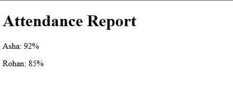

# Experiment No. 4

## Experiment Title
Divs, Attributes and a Small Fix

## Aim
Group parts of a page with div elements, add a data attribute, and fix the errors in a broken page.

## Software / Tools Required
HTML5, CSS3, Visual Studio Code (with Live Server), Google Chrome

## Theory
- div is a block container used to group parts of a page.
- A class can be used on many elements, while an id must be unique on a page.
- A data-* attribute stores extra information in an element. It is not shown on the page.
- Common HTML errors are tags that are not closed and wrong closing tags. Browsers try to fix them, but the code should be corrected.

## Algorithm / Procedure
1. Open Visual Studio Code and create the folder Lab4.
2. Task 1: layout.html: three divs with classes header, main and footer.
3. Task 2: attributes.html: div id profile with a paragraph that has data-topic=hobbies.
4. Task 3: attendance-fixed.html: the broken page fixed (unclosed h1 and the wrong p tag).
5. Save all the files.
6. Open each html file with Live Server in Google Chrome.
7. Check the page and take a screenshot of each task and save it in the images folder.

## Program / Commands
### layout.html
```html
<!DOCTYPE html>
<html lang="en">
<head>
  <meta charset="UTF-8">
  <title>Layout</title>
</head>
<body>
  <div class="header">This is the header</div>
  <div class="main">This is the main part</div>
  <div class="footer">This is the footer</div>
</body>
</html>
```

### attributes.html
```html
<!DOCTYPE html>
<html lang="en">
<head>
  <meta charset="UTF-8">
  <title>Attributes</title>
</head>
<body>
  <div id="profile">
    <p data-topic="hobbies">My hobbies are gaming and cricket.</p>
  </div>
</body>
</html>
```

### attendance-fixed.html
```html
<!DOCTYPE html>
<html>
<head>
<title>Attendance</title>
</head>
<body>
<h1>Attendance Report</h1>
<p>Asha: 92%</p>
<p>Rohan: 85%</p>
</body>
</html>
```

## Input
Not Applicable. The values are written inside the program.

## Output
Expected output: Three blocks in order. The paragraph text shows (data-topic is hidden). The fixed page shows the heading and two lines: Asha: 92% and Rohan: 85%. Errors fixed: h1 was not closed, and the second tag in the Asha line was <p> instead of </p>.




## Result
The experiment was performed successfully. Parts of a page were grouped with div elements, attributes were used and the errors of the broken page were corrected.

## Viva-Voce Questions
1. What is a div?
2. What is the difference between class and id?
3. What is a data attribute?
4. What is wrong with a tag that is not closed?
