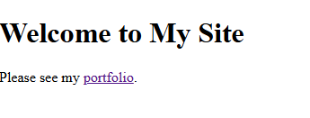
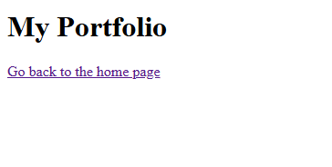
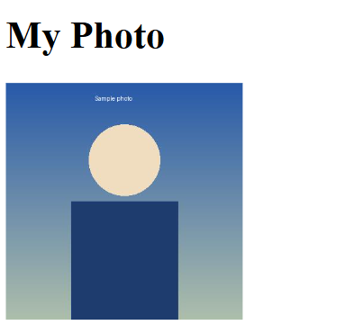

# Experiment No. 5

## Experiment Title
Links and Images

## Aim
Link two pages together and add a picture with alt text.

## Software / Tools Required
HTML5, CSS3, Visual Studio Code (with Live Server), Google Chrome

## Theory
- The a tag with href makes a link. A link to a file in the same folder only needs the file name.
- The img tag shows a picture. src gives the file, width and height give the size, and alt gives text that shows if the picture is missing and is read by screen readers.

## Algorithm / Procedure
1. Open Visual Studio Code and create the folder Lab5.
2. Task 1: home.html: heading and a link to portfolio.html (link text: portfolio).
3. Task 2: portfolio.html: heading and a link back to home.html.
4. Task 3: portfolio-image.html: heading and a 200 x 200 picture from the images folder with alt text.
5. Save all the files.
6. Open each html file with Live Server in Google Chrome.
7. Check the page and take a screenshot of each task and save it in the images folder.

## Program / Commands
### home.html
```html
<!DOCTYPE html>
<html lang="en">
<head>
  <meta charset="UTF-8">
  <title>Home</title>
</head>
<body>
  <h1>Welcome to My Site</h1>
  <p>Please see my <a href="portfolio.html">portfolio</a>.</p>
</body>
</html>
```

### portfolio.html
```html
<!DOCTYPE html>
<html lang="en">
<head>
  <meta charset="UTF-8">
  <title>Portfolio</title>
</head>
<body>
  <h1>My Portfolio</h1>
  <p><a href="home.html">Go back to the home page</a></p>
</body>
</html>
```

### portfolio-image.html
```html
<!DOCTYPE html>
<html lang="en">
<head>
  <meta charset="UTF-8">
  <title>Portfolio Image</title>
</head>
<body>
  <h1>My Photo</h1>
  
</body>
</html>
```

## Input
Not Applicable. The values are written inside the program.

## Output
Expected output: Clicking portfolio opens the portfolio page, and the link there goes back. The image page shows a 200 by 200 picture; if the picture is missing the alt text shows.





## Result
The experiment was performed successfully. Pages were linked to each other and an image with alt text was added.

## Viva-Voce Questions
1. What is the use of the a tag?
2. What is alt text?
3. What is the difference between a relative link and an absolute link?
4. Which attributes set the size of an image?
