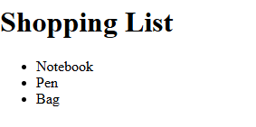
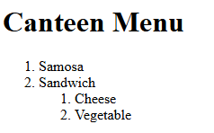
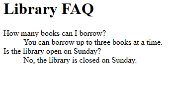

# Experiment No. 6

## Experiment Title
Types of HTML Lists

## Aim
Make a bulleted list, a numbered list with a nested list, and a description list.

## Software / Tools Required
HTML5, CSS3, Visual Studio Code (with Live Server), Google Chrome

## Theory
- ul makes a bulleted list and ol makes a numbered list. Each item is written in li.
- A list can be placed inside an li to make a nested list.
- A description list (dl) has terms in dt and their descriptions in dd.

## Algorithm / Procedure
1. Open Visual Studio Code and create the folder Lab6.
2. Task 1: shopping-list.html: unordered list Notebook, Pen, Bag.
3. Task 2: canteen-menu.html: ordered list Samosa, Sandwich with a nested ordered list Cheese, Vegetable under Sandwich.
4. Task 3: faq.html: description list of two questions (dt) with answers (dd).
5. Save all the files.
6. Open each html file with Live Server in Google Chrome.
7. Check the page and take a screenshot of each task and save it in the images folder.

## Program / Commands
### shopping-list.html
```html
<!DOCTYPE html>
<html lang="en">
<head>
  <meta charset="UTF-8">
  <title>Shopping List</title>
</head>
<body>
  <h1>Shopping List</h1>
  <ul>
    <li>Notebook</li>
    <li>Pen</li>
    <li>Bag</li>
  </ul>
</body>
</html>
```

### canteen-menu.html
```html
<!DOCTYPE html>
<html lang="en">
<head>
  <meta charset="UTF-8">
  <title>Canteen Menu</title>
</head>
<body>
  <h1>Canteen Menu</h1>
  <ol>
    <li>Samosa</li>
    <li>Sandwich
      <ol>
        <li>Cheese</li>
        <li>Vegetable</li>
      </ol>
    </li>
  </ol>
</body>
</html>
```

### faq.html
```html
<!DOCTYPE html>
<html lang="en">
<head>
  <meta charset="UTF-8">
  <title>FAQ</title>
</head>
<body>
  <h1>Library FAQ</h1>
  <dl>
    <dt>How many books can I borrow?</dt>
    <dd>You can borrow up to three books at a time.</dd>
    <dt>Is the library open on Sunday?</dt>
    <dd>No, the library is closed on Sunday.</dd>
  </dl>
</body>
</html>
```

## Input
Not Applicable. The values are written inside the program.

## Output
Expected output: Three bullet points. Two numbered items with a smaller numbered list under the second. Two questions each followed by its answer.





## Result
The experiment was performed successfully. Unordered, ordered, nested and description lists were created.

## Viva-Voce Questions
1. What is the difference between ul and ol?
2. How is a nested list written?
3. What are dl, dt and dd?
4. Which tag makes a list item?
