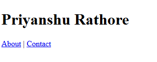
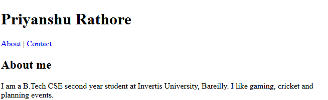
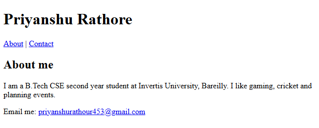

# Experiment No. 7

## Experiment Title
About Me Page

## Aim
Build a short About Me page with semantic tags, an about section and a contact link.

## Software / Tools Required
HTML5, CSS3, Visual Studio Code (with Live Server), Google Chrome

## Theory
- Semantic tags (header, nav, main, section, footer) describe the meaning of each part of a page.
- A link to #about jumps to the element with id about on the same page.
- A link that starts with mailto: opens the email app.

## Algorithm / Procedure
1. Open Visual Studio Code and create the folder Lab7.
2. Task 1: about-me.html: header with h1 name and nav (About to #about, Contact to #contact), main and footer.
3. Task 2: Add a section with id about inside main, with h2 About me and a paragraph.
4. Task 3: Add a paragraph with a mailto link inside the footer with id contact.
5. Save all the files.
6. Open each html file with Live Server in Google Chrome.
7. Check the page and take a screenshot of each task and save it in the images folder.

## Program / Commands
### about-me.html
```html
<!DOCTYPE html>
<html lang="en">
<head>
  <meta charset="UTF-8">
  <title>About Me</title>
</head>
<body>
  <header>
    <h1>Priyanshu Rathore</h1>
    <nav>
      <a href="#about">About</a> |
      <a href="#contact">Contact</a>
    </nav>
  </header>

  <main>
    <section id="about">
      <h2>About me</h2>
      <p>I am a B.Tech CSE second year student at Invertis University, Bareilly. I like gaming, cricket and planning events.</p>
    </section>
  </main>

  <footer id="contact">
    <p>Email me: <a href="mailto:your-email@example.com">your-email@example.com</a></p>
  </footer>
</body>
</html>
```

## Input
Not Applicable. The values are written inside the program.

## Output
Expected output: Your name at the top with two links, an About me section in the middle and a clickable email in the footer. The Contact link jumps to the footer.





## Result
The experiment was performed successfully. A page with semantic tags, section links and an email link was created.

## Viva-Voce Questions
1. What are semantic tags?
2. How does a link to #about work?
3. What does mailto do?
4. Name three semantic tags.
