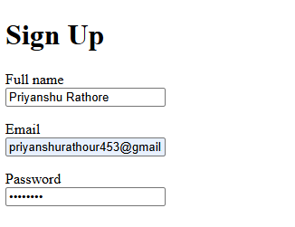
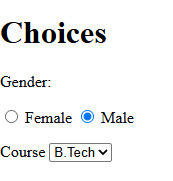
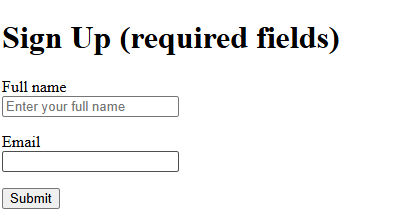

# Experiment No. 8

## Experiment Title
Sign-Up Forms and Choices

## Aim
Make a labelled form with text, email and password fields, choices and a submit button.

## Software / Tools Required
HTML5, CSS3, Visual Studio Code (with Live Server), Google Chrome

## Theory
- A form collects input. method and action say how and where the data is sent.
- A label is linked to a field with for and id, so clicking the label selects the field.
- input types include text, email and password (which hides the characters). Radio buttons with the same name allow only one choice. select with option makes a dropdown.
- required stops the form from being sent with an empty field, and placeholder shows a hint inside the field.

## Algorithm / Procedure
1. Open Visual Studio Code and create the folder Lab8.
2. Task 1: signup.html: form (post, action thanks.html) with labelled full name, email and password.
3. Task 2: choices.html: gender radio buttons (Female, Male) and a course dropdown (BCA, B.Tech).
4. Task 3: signup-required.html: required name and email fields, placeholder on name, Submit button.
5. Save all the files.
6. Open each html file with Live Server in Google Chrome.
7. Check the page and take a screenshot of each task and save it in the images folder.

## Program / Commands
### signup.html
```html
<!DOCTYPE html>
<html lang="en">
<head>
  <meta charset="UTF-8">
  <title>Sign Up</title>
</head>
<body>
  <h1>Sign Up</h1>
  <form method="post" action="thanks.html">
    <p>
      <label for="fullname">Full name</label><br>
      <input type="text" id="fullname" name="fullname">
    </p>
    <p>
      <label for="email">Email</label><br>
      <input type="email" id="email" name="email">
    </p>
    <p>
      <label for="password">Password</label><br>
      <input type="password" id="password" name="password">
    </p>
  </form>
</body>
</html>
```

### choices.html
```html
<!DOCTYPE html>
<html lang="en">
<head>
  <meta charset="UTF-8">
  <title>Choices</title>
</head>
<body>
  <h1>Choices</h1>
  <form>
    <p>Gender:</p>
    <input type="radio" id="female" name="gender" value="female">
    <label for="female">Female</label>
    <input type="radio" id="male" name="gender" value="male">
    <label for="male">Male</label>

    <p>
      <label for="course">Course</label>
      <select id="course" name="course">
        <option value="bca">BCA</option>
        <option value="btech">B.Tech</option>
      </select>
    </p>
  </form>
</body>
</html>
```

### signup-required.html
```html
<!DOCTYPE html>
<html lang="en">
<head>
  <meta charset="UTF-8">
  <title>Required Sign Up</title>
</head>
<body>
  <h1>Sign Up (required fields)</h1>
  <form>
    <p>
      <label for="fullname">Full name</label><br>
      <input type="text" id="fullname" name="fullname" placeholder="Enter your full name" required>
    </p>
    <p>
      <label for="email">Email</label><br>
      <input type="email" id="email" name="email" required>
    </p>
    <button type="submit">Submit</button>
  </form>
</body>
</html>
```

## Input
Values typed in the form fields (full name, email and password), and the gender and course chosen.

## Output
Expected output: Three labelled boxes (password hides what you type). Only one gender can be selected, dropdown shows two courses. Submitting with an empty required field shows a browser message.





## Result
The experiment was performed successfully. Forms with labelled fields, radio buttons, a dropdown and required fields were created.

## Viva-Voce Questions
1. What is the use of the label tag?
2. What is the difference between GET and POST?
3. How do radio buttons work as a group?
4. What do required and placeholder do?
