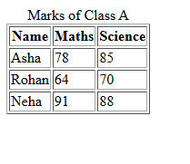
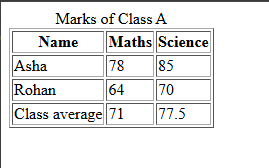
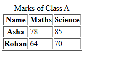

# Experiment No. 9

## Experiment Title
Tables with Headers and Footers

## Aim
Build a table with a caption, a header, rows and a footer, and add scope attributes.

## Software / Tools Required
HTML5, CSS3, Visual Studio Code (with Live Server), Google Chrome

## Theory
- A table uses tr for rows, th for header cells and td for data cells. caption gives the table a title.
- thead, tbody and tfoot group the header, body and footer rows.
- scope=col and scope=row tell screen readers whether a header cell is for a column or a row.

## Algorithm / Procedure
1. Open Visual Studio Code and create the folder Lab9.
2. Task 1: marks.html: table with caption, thead and tbody (Asha, Rohan, Neha).
3. Task 2: marks-average.html: Asha and Rohan rows and a tfoot row Class average.
4. Task 3: marks-accessible.html: same as above without the footer, with scope attributes.
5. Save all the files.
6. Open each html file with Live Server in Google Chrome.
7. Check the page and take a screenshot of each task and save it in the images folder.

## Program / Commands
### marks.html
```html
<!DOCTYPE html>
<html lang="en">
<head>
  <meta charset="UTF-8">
  <title>Marks</title>
</head>
<body>
  <table border="1">
    <caption>Marks of Class A</caption>
    <thead>
      <tr><th>Name</th><th>Maths</th><th>Science</th></tr>
    </thead>
    <tbody>
      <tr><td>Asha</td><td>78</td><td>85</td></tr>
      <tr><td>Rohan</td><td>64</td><td>70</td></tr>
      <tr><td>Neha</td><td>91</td><td>88</td></tr>
    </tbody>
  </table>
</body>
</html>
```

### marks-average.html
```html
<!DOCTYPE html>
<html lang="en">
<head>
  <meta charset="UTF-8">
  <title>Marks Average</title>
</head>
<body>
  <table border="1">
    <caption>Marks of Class A</caption>
    <thead>
      <tr><th>Name</th><th>Maths</th><th>Science</th></tr>
    </thead>
    <tbody>
      <tr><td>Asha</td><td>78</td><td>85</td></tr>
      <tr><td>Rohan</td><td>64</td><td>70</td></tr>
    </tbody>
    <tfoot>
      <tr><td>Class average</td><td>71</td><td>77.5</td></tr>
    </tfoot>
  </table>
</body>
</html>
```

### marks-accessible.html
```html
<!DOCTYPE html>
<html lang="en">
<head>
  <meta charset="UTF-8">
  <title>Marks Accessible</title>
</head>
<body>
  <table border="1">
    <caption>Marks of Class A</caption>
    <thead>
      <tr>
        <th scope="col">Name</th>
        <th scope="col">Maths</th>
        <th scope="col">Science</th>
      </tr>
    </thead>
    <tbody>
      <tr><th scope="row">Asha</th><td>78</td><td>85</td></tr>
      <tr><th scope="row">Rohan</th><td>64</td><td>70</td></tr>
    </tbody>
  </table>
</body>
</html>
```

## Input
Not Applicable. The values are written inside the program.

## Output
Expected output: A table with a header row and student rows. The footer shows averages: Maths (78+64)/2 = 71, Science (85+70)/2 = 77.5. The accessible table looks the same; scope attributes can be seen in the Elements panel (F12).





## Result
The experiment was performed successfully. Tables with a caption, header, body, footer and scope attributes were created.

## Viva-Voce Questions
1. What is the difference between th and td?
2. What are thead, tbody and tfoot?
3. What does the scope attribute do?
4. What is the use of caption?
